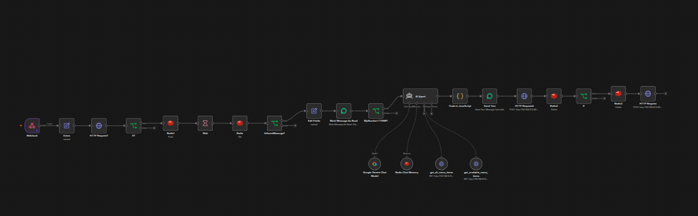

# HelpAI

Sistema de atendimento automatizado para pedidos de restaurante via WhatsApp. O projeto combina uma aplicação Laravel, painel administrativo Filament, Evolution API, n8n, Redis e Google Gemini.

## Visão geral

Fluxo principal:

1. O cliente envia uma mensagem pelo WhatsApp.
2. A Evolution API encaminha o evento para o webhook Laravel.
3. O Laravel valida e persiste a mensagem.
4. O Laravel envia a mensagem para o webhook do n8n.
5. O n8n agrupa mensagens, consulta o cardápio e processa a conversa com Google Gemini.
6. A resposta retorna ao cliente pela Evolution API.
7. O n8n persiste a resposta no Laravel.
8. Após a confirmação do pedido, o n8n envia os dados para o webhook de pedidos.
9. O Laravel cria o pedido e atualiza o painel administrativo em tempo real.

## Automação n8n

Arquivo principal:

```text
n8n/workflow.json
```

Workflow: `automação`.



### Sequência

1. `Webhook` recebe a mensagem.
2. `Datas` normaliza nome, texto, tipo, IDs, telefone, instância e horário.
3. `HTTP Request1` consulta o estado da conversa no Laravel.
4. `If1` decide se a mensagem continua no fluxo.
5. `Redis1` agrupa mensagens por telefone.
6. `Wait` aguarda 15 segundos para reunir mensagens próximas.
7. `Redis` recupera a fila `Messages`.
8. `IsSameMessage?` garante que somente a mensagem mais recente avance.
9. `Mark Message As Read` marca a mensagem na Evolution API.
10. `AI Agent` interpreta a conversa e conduz o atendimento.
11. `Google Gemini Chat Model` fornece o modelo de linguagem.
12. `Redis Chat Memory` mantém contexto por conversa.
13. `get_all_menu_items` e `get_available_menu_items` consultam o Laravel.
14. `Code in JavaScript` normaliza resposta, pedido, entrega, pagamento, total e status.
15. `Send Text` envia a resposta ao cliente.
16. `HTTP Request4` salva a resposta no Laravel.
17. `Redis2` limpa a fila do telefone.
18. `If` verifica `ConversationFinished`.
19. `Redis3` limpa a memória temporária da conversa.
20. `HTTP Request` envia o pedido finalizado para `/api/webhook/order`.

### Regras do agente

O agente atende em português brasileiro e conduz:

- Seleção de itens do cardápio
- Quantidade e preço
- Marmitas e bebidas
- Entrega ou retirada
- Endereço de entrega
- Momento do pagamento
- Confirmação do pedido
- Total final

`ConversationFinished` só deve ser `true` após confirmação explícita do cliente e preenchimento dos dados obrigatórios.

### Credenciais

O workflow referencia credenciais do n8n para:

- Google Gemini
- Redis
- Evolution API

O arquivo contém nomes e IDs de credenciais, não segredos. Configure credenciais no n8n e não publique chaves no repositório.

### Pontos de operação

- O workflow possui URLs internas configuradas diretamente em alguns nós. Ajuste-as para cada ambiente.
- O `pinData` do arquivo pode conter payloads de execução e dados de WhatsApp. Revise esses dados antes de compartilhar o workflow.
- O Laravel precisa estar acessível pelo n8n.
- Redis deve ser compartilhado ou corretamente endereçado entre Laravel e n8n quando a aplicação depender do mesmo estado.
- O workflow usa uma espera de 15 segundos para agrupar mensagens consecutivas.

## Stacks

### Backend

- PHP `^8.3`
- Laravel `^13.17`
- Livewire `^4.1`
- Filament `^5.9`
- Laravel Fortify `^1.37.2`
- Laravel Sanctum `^4.0`
- Laravel Reverb `^1.0`
- Pusher PHP `^7.3`

### Frontend

- Node.js e npm
- Vite `^8.0.0`
- Vite Plus `0.3.0`
- Tailwind CSS `^4.0.7`
- Laravel Vite Plugin `^3.1`
- Laravel Echo `^2.5.0`
- Pusher JS `^8.6.0`
- Blade, Alpine.js e Livewire

### Qualidade

- PHPUnit `^12.5.23`
- Larastan `^3.9`
- Laravel Pint `^1.27`

### Serviços de infraestrutura

- MySQL ou SQLite para desenvolvimento
- PostgreSQL para o ambiente do n8n
- Redis para cache, filas, agrupamento e memória conversacional
- Evolution API para integração com WhatsApp
- n8n para automação
- Google Gemini para processamento de linguagem e transcrição de áudio
- Laravel Reverb/Pusher para eventos em tempo real

## Estrutura do projeto

```text
app/
├── Actions/              Ações de autenticação e regras de negócio
├── Events/               Eventos broadcast, incluindo criação de pedidos
├── Filament/Resources/   CRUDs do painel administrativo
├── Http/Controllers/     Webhooks, conversas e cardápio
├── Models/               Modelos User, Orders, Menu e Whatsapp
├── Providers/            Configuração da aplicação e do Filament
└── Services/             Evolution API, pedidos e estado da conversa

database/
├── factories/            Factories para testes
├── migrations/           Estrutura do banco
└── seeders/              Dados iniciais

resources/
├── css/                  Estilos
├── js/                   JavaScript, Echo e passkeys
└── views/                Views Blade e telas do painel

routes/
├── api.php               Endpoints da API e webhooks
├── channels.php          Canais broadcast
├── settings.php          Rotas de configurações
└── web.php               Rotas web e painel

n8n/
├── docker-compose.yml    Serviços n8n, Evolution API, Redis e PostgreSQL
└── workflow.json         Workflow de atendimento automatizado
```

## Requisitos

- PHP `8.3` ou superior
- Composer
- Node.js e npm
- MySQL ou SQLite
- Redis
- Docker e Docker Compose, caso os serviços de automação sejam executados localmente

## Instalação

O comando de setup instala dependências, cria o ambiente, gera a chave, executa migrations e compila os assets:

```bash
composer run setup
```

Instalação manual:

```bash
composer install
cp .env.example .env
php artisan key:generate
php artisan migrate
npm install
npm run build
```

Configure o arquivo `.env` antes de iniciar a aplicação. Nunca versiona `.env` ou credenciais de serviços externos.

## Configuração de ambiente

Variáveis principais:

```env
APP_NAME=
APP_ENV=
APP_KEY=
APP_DEBUG=
APP_URL=

DB_CONNECTION=
DB_HOST=
DB_PORT=
DB_DATABASE=
DB_USERNAME=
DB_PASSWORD=

SESSION_DRIVER=
CACHE_STORE=
QUEUE_CONNECTION=

REDIS_CLIENT=
REDIS_HOST=
REDIS_PASSWORD=
REDIS_PORT=

BROADCAST_CONNECTION=
FILESYSTEM_DISK=

N8N_WHATSAPP_WEBHOOK_URL=
EVOLUTION_API_URL=
GEMINI_INTERACTIONS_URL=
GEMINI_API_KEY=

VITE_APP_NAME=
VITE_REVERB_APP_KEY=
VITE_REVERB_HOST=
VITE_REVERB_PORT=
VITE_REVERB_SCHEME=
```

O projeto aceita SQLite, MySQL/MariaDB, PostgreSQL e SQL Server via configuração do Laravel. O ambiente local pode usar SQLite, enquanto o `.env` de produção deve apontar para o banco escolhido.

## Execução

### Laravel

Executa o ambiente de desenvolvimento configurado no projeto:

```bash
composer run dev
```

### Frontend

Servidor de desenvolvimento:

```bash
npm run dev
```

Build de produção:

```bash
npm run build
```

### Serviços n8n

Na pasta `n8n/`:

```bash
docker compose up -d
```

Serviços definidos em `n8n/docker-compose.yml`:

| Serviço | Imagem | Porta |
|---|---|---:|
| n8n | `docker.n8n.io/n8nio/n8n:latest` | `5678` |
| Evolution API | `evoapicloud/evolution-api:latest` | `8080` |
| Redis | `redis:7-alpine` | interna |
| PostgreSQL | `postgres:16-alpine` | interna |

O Laravel roda separadamente. Os endpoints usados pelo workflow precisam estar acessíveis pelo ambiente onde o n8n está executando.

## Endpoints principais

| Método | Endpoint | Função |
|---|---|---|
| `POST` | `/api/webhook/evolution` | Recebe eventos da Evolution API |
| `POST` | `/api/webhook/order` | Recebe pedidos finalizados pelo n8n |
| `POST` | `/api/saveMessage` | Persiste mensagens geradas pela automação |
| `GET` | `/api/conversation/{remoteJid}/finished` | Consulta se a conversa foi finalizada |
| `GET` | `/api/menu/all` | Lista todo o cardápio |
| `GET` | `/api/menu/available` | Lista itens disponíveis |
| `GET` | `/api/user` | Retorna usuário autenticado |
| `POST` | `/admin/whatsapp/messages` | Envia mensagem pelo painel |
| `GET` | `/admin/whatsapp/conversation-messages` | Consulta mensagens da conversa |

## Domínios de negócio

### Mensagens WhatsApp

`EvolutionService` processa eventos `messages.upsert`, evita duplicidade por `message_id`, salva mensagens e encaminha dados ao n8n.

Mensagens de áudio são armazenadas em `storage/app/public/whatsapp/audio` e transcritas pelo endpoint configurado em `GEMINI_INTERACTIONS_URL`.

O painel permite consultar conversas e enviar mensagens pela Evolution API.

### Cardápio

Os recursos Filament e os endpoints de menu expõem itens, preços, categorias, tamanhos e disponibilidade.

O agente n8n deve consultar as ferramentas de cardápio. Preços e disponibilidade não devem ser inferidos somente pelo texto da conversa.

### Pedidos

`OrderService` cria pedidos com status inicial `pending`, salva dados de entrega e pagamento, dispara o evento `OrderCreated` e marca a conversa como finalizada temporariamente no Redis.

O evento é transmitido no canal público `orders`, permitindo atualização em tempo real no painel.

## Painel administrativo

O painel Filament fica disponível em:

```text
/admin
```

Recursos principais:

- Menus
- Pedidos
- WhatsApp e mensagens

O painel usa autenticação, notificações persistidas, Livewire e atualização em tempo real via Reverb/Pusher.

## Testes e qualidade

Executa lint com correção:

```bash
composer run lint
```

Verifica lint sem alterar arquivos:

```bash
composer run lint:check
```

Executa análise estática:

```bash
composer run types:check
```

Executa suite completa:

```bash
composer run test
```

A suite PHPUnit usa configurações isoladas para testes, incluindo cache em memória, fila síncrona, sessão em array e broadcast nulo.

## Persistência

Entidades principais:

- `users`: usuários e autenticação
- `orders`: pedidos, cliente, telefone, status, total e timestamps
- `menu`: itens, preços, categorias, tamanhos e disponibilidade
- `whatsapp`: mensagens, remetente, tipo, IDs da Evolution API, instância, áudio e conversa

O Laravel também usa tabelas para sessões, cache e jobs quando os drivers configurados usam banco.

## Segurança e operação

- Não versione `.env`, chaves de API, tokens ou senhas.
- Troque credenciais padrão do Docker antes de expor serviços.
- Restrinja endpoints de webhook por rede, assinatura ou autenticação quando possível.
- Revise URLs internas e dados em `pinData` antes de exportar o workflow.
- Use HTTPS em ambientes acessíveis pela internet.
- Mantenha volumes Docker persistentes e faça backup do PostgreSQL, Redis e dados do n8n.

## Licença

Nenhuma licença foi identificada no repositório. Defina uma licença antes de distribuir o projeto.
